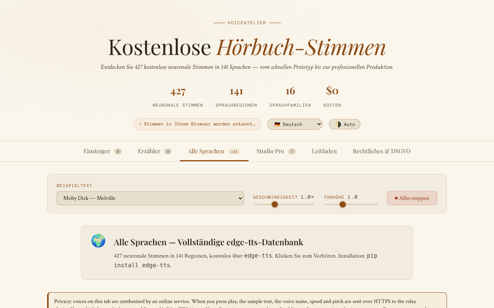

# VoiceAtelier

[English](README.md) · [Română](README.ro.md) · [Français](README.fr.md) · [Italiano](README.it.md) · [Español](README.es.md) · [Português](README.pt.md) · **Deutsch** · [Magyar](README.hu.md)

**Version:** 1.3.8 · **Zuletzt aktualisiert:** 2026-10-26

Oberflächensprachen: **Română, English, Français, Italiano, Español, Português (PT), Deutsch, Magyar** + 8 weitere

Katalog und Leitfaden für kostenlose neuronale Stimmen für Hörbücher, in einer einzigen HTML-Datei.

**Online:** https://chiuta.github.io/VoiceAtelier/

## Was es ist

VoiceAtelier ist eine Anwendung in einer einzigen Datei `index.html`, die Sprachsynthese-Stimmen vorstellt, die kostenlos für Hörbuchsprecher-Aufgaben genutzt werden können. Die Oberfläche nennt 427 neuronale Stimmen in 141 Sprachen, nach Stufen geordnet (Starter, Storyteller, Alle Sprachen, Studio Pro), und enthält einen Workflow-Leitfaden für Langform-Erzählungen.

## Funktionen

- Sechs Bereiche (Tabs): **Starter**, **Storyteller**, **Alle Sprachen**, **Studio Pro**, **Leitfaden**, **Rechtliches & DSGVO**.
- Probewiedergabe der im Browser verfügbaren Stimmen über die Web Speech API (`speechSynthesis`).
- Beispieltext aus einer Liste auswählbar (Auszüge aus Moby Dick, Pride & Prejudice, A Tale of Two Cities, The Time Machine, Anna Karenina, Mrs Dalloway, *Printre inteligențe*, *Nota Zero*), mit Reglern für Geschwindigkeit und Tonhöhe und einer Schaltfläche „Alles stoppen“.
- Der Tab „Alle Sprachen“: ein Sprachraster mit Suche, einer Probe-Schaltfläche und einer Schaltfläche zum Kopieren des `edge-tts`-Befehls für jede Sprache.
- Studio Pro: Steckbriefe zu ElevenLabs, Microsoft Edge TTS, Kokoro TTS, Bark, Google Cloud TTS, Coqui TTS und Amazon Polly (Limits, Sprachen, Formate, Link).
- Leitfaden: Erklärung der drei Stufen, Kriterien für die Stimmenwahl, Workflow mit `edge-tts`, Audacity und ffmpeg (`loudnorm`), ACX/Audible-Anforderungen.
- Oberfläche in 16 Sprachen: en, ro, fr, de, es, pt, it, nl, pl, ru, ar, zh, ja, ko, tr, hu.
- Automatisches/helles/dunkles Design.
- Informationsfenster (DSGVO, Cookies, Impressum, Barrierefreiheit, Takedown usw.).

## Bedienungsanleitung

1. Öffne die Seite. Die Sprache der Oberfläche wird automatisch erkannt; du kannst sie über die Liste „Language“ in der Kopfzeile ändern.
2. Wechsle das Design mit der Schaltfläche in der Kopfzeile (sie wechselt zwischen automatisch, hell, dunkel).
3. Wähle einen Text unter „Beispieltext“; passe „Geschwindigkeit“ und „Tonhöhe“ an.
4. Drücke in **Starter** und **Storyteller** auf ▶ auf der Karte einer Stimme, um sie zu hören (per Tastatur: Tab bis zur ▶-Schaltfläche, dann Eingabe oder Leertaste). Das Abzeichen „On-device“ kennzeichnet lokale Stimmen; die vom Browser/System über das Netzwerk bereitgestellten tragen das Abzeichen „Online-Stimme“.
5. Suche in **Alle Sprachen** eine Sprache und drücke dann die Probe-Schaltfläche oder die Schaltfläche zum Kopieren des `edge-tts`-Befehls.
6. Drücke „⏹ Alles stoppen“, um die Wiedergabe anzuhalten.
7. Siehe **Studio Pro** für externe Werkzeuge und **Leitfaden** für den Workflow.
8. Escape schließt die modalen Fenster.

## Datenschutz und Netzwerk

- **Lokaler Speicher:** `localStorage`, Schlüssel `va_lang` (Sprache) und `va_theme` (Design). Optional der Schlüssel `va_endpoint`, wenn du manuell ein anderes TTS-Relay festlegst.
- **Netzwerk:** Die Stimmen in den Tabs Starter und Storyteller laufen lokal über die Web Speech API (die Anwendung weist darauf hin, dass die Verantwortung beim Browseranbieter liegt, falls der Browser den Text intern an einen Server sendet).
- **Ausdrückliches Opt-in:** Im Tab „Alle Sprachen“ (standardmäßig geöffnet) erklärt ein sichtbarer Hinweis, was gesendet wird, und Online-Stimmen werden **erst nach dem Anhaken** der Einwilligung („Ich verstehe und stimme zu…“) wiedergegeben. Ohne Häkchen wird nichts gesendet (geprüft: 0 Anfragen beim Laden und beim Klick ohne Häkchen). Das Häkchen wird in `localStorage` gespeichert (`va_relay_ok`).
- Bei der Wiedergabe einer Stimme aus dem Tab „Alle Sprachen“ werden der Beispieltext, der Stimmenname, die Geschwindigkeit und die Tonhöhe per HTTPS (`fetch`) an das Relay **https://alexio.tf/tts** gesendet, das mit `edge-tts` MP3-Audio erzeugt und zurückgibt. **`edge-tts` ist eine inoffizielle Bibliothek, die den Online-Dienst Microsoft Edge TTS nutzt: Der Text wird daher an Microsoft weitergeleitet**, das ihn nach seinen eigenen Bedingungen verarbeitet (inoffiziell, ohne Verfügbarkeitsgarantie; „kostenlos“ hängt von diesem Dienst ab). Laut dem Hinweis in der Anwendung speichert das Relay den Text nach der Anfrage nicht (die Aussage betrifft den Server des Autors und lässt sich aus diesem Repository nicht überprüfen).
- CSP: `connect-src 'self' https://alexio.tf`. Der Schlüssel `va_endpoint` (ein manuell in `localStorage` gesetztes alternatives Relay) funktioniert nur für Adressen auf `alexio.tf`; für ein anderes Relay muss die CSP in `index.html` erweitert werden.
- **Achtung:** Das Relay erzeugt Audio mit `edge-tts`, einem inoffiziellen Client für den Online-Dienst Microsoft Edge/Azure TTS; es ist daher wahrscheinlich, dass der Beispieltext auch an Microsoft weitergeleitet wird.
- Links zu anderen Websites (ElevenLabs, GitHub, Hugging Face, Buy Me a Coffee usw.) sind einfache Hyperlinks, die nur per Klick geöffnet werden.
- Die Anwendung enthält weder Analytics noch Registrierungsformulare.

## Lokal / offline ausführen

Lade `index.html` herunter und öffne sie im Browser. Die Schriftarten sind in der Datei enthalten. Die Tabs Starter und Storyteller funktionieren ohne Internet, im Rahmen der im System/Browser installierten Stimmen. Die Wiedergabe aus „Alle Sprachen“ erfordert Internet und Zugriff auf `alexio.tf`.

## Verlauf / Changelog

- 1.3.7 — 2026-10-23: auf Touchscreens (`pointer: coarse`) haben Stimmen-Schaltflächen, Beispiel-/Such-/Filterfelder, Theme- und Stopp-Schaltflächen sowie die Schaltflächen der rechtlichen Fußzeile ein Touch-Ziel von 44 px.
- 1.3.5 — 2026-10-22: fff-kit 1.1.4: Touch-Ziele und Mindestschriftgröße; Touch-Ziele/Text korrigiert
- 1.3.4 — 2026-10-22: fff-kit 1.1.2: PBKDF2 mit 600.000 Iterationen, Schutz vor Clickjacking.
- 1.3.3 — 2026-10-22: Mobil-Durchgang bei 360 px: aller Text ≥ 12 px, Ziele ≥ 24 px (Stimmen-Pillen, Schieberegler, Kontrollkästchen, Fußzeilenlinks; Tabs und Schaltflächen ≥ 36 px); Versionsangabe in der Fußzeile synchronisiert.

- 1.3.2 — 2026-10-22: Fehlende Texte auf Französisch, Italienisch, Spanisch, Portugiesisch und Deutsch ergänzt (Datenschutzhinweis und Einwilligung für Online-Stimmen, Stimmenzähler, Werkzeugbeschreibungen im Studio-Tab); Meta-Beschreibung und Beschreibung im fff-kit-Panel folgen der Oberflächensprache.
- 1.2.0 — 2026-10-18: Neues Beispiel in der Liste: *Nota Zero* (zwei Sätze aus Bd. I).
- 1.1.0 — 2026-10-14: Datensicherung und Datenkennzeichnung (fff-kit).

- 1.0.0 — 2026-10-12: Die Version und das Datum der letzten Aktualisierung werden in der Anwendung angezeigt
- Runde 7: Die unbelegte Behauptung, die Studio-Pro-Werkzeuge erzeugten in allen 15 Sprachen Audio „indistinguishable from professional narration“ (und „Broadcast-Qualität“), wurde entfernt — der Text sagt jetzt, dass die Natürlichkeit von Stimme zu Stimme variiert, und empfiehlt, die Hörproben anzuhören; der Leerzustand in Starter/Storyteller (keine lokalen Stimmen) hat nun eine Schaltfläche „→ Alle Sprachen“, die direkt zu den Online-Stimmen führt.
- Browserstimmen, die nicht lokal sind (`localService = false`), erhalten das Abzeichen „Online-Stimme“ (in die 15 Sprachen übersetzt), damit klar ist, wann der Text an den Browseranbieter gehen kann; die Stimmenkarte ist nicht mehr `role="button"` mit einer ▶-Schaltfläche darin (axe-Verstoß „nested-interactive“, nur sichtbar, wenn Stimmen vorhanden sind), und die ▶-Schaltfläche ist das fokussierbare Bedienelement; CSP: `script-src` per SHA-256-Hash (2 Skripte), ohne `'unsafe-inline'`.
- Alle 44 Inline-Handler (`onclick`/`oninput`/`onchange`) wurden entfernt; die Aktionen verwenden nun die Attribute `data-click`/`data-input`/`data-change`/`data-overlay` und delegierte Listener.
- Gibt es keine lokale Stimme (auch nach 5 s nicht), zeigen die Seiten Starter/Storyteller nun in allen 15 Sprachen einen ausdrücklichen Leerzustand mit Verweis auf den Tab „Alle Sprachen“ statt „Loading voices…“.
- Marketingtexte abgemildert: „The gold standard“ → „A leading commercial service“, „Unlimited (unofficial)“ → „No published limit (unofficial)“.
- Das Unterstützungs-Widget ist eine `complementary`-Landmarke; axe-core: 0 Verstöße bei 1280 und 360 px. Der Netzwerkabschnitt der README wurde korrigiert (aktuelle CSP: `connect-src 'self' https://alexio.tf`).

## Lizenz

MIT — siehe Datei LICENSE

## Audit

2026-10-10: Die Anzahl der Stimmen (427) und Sprachen (141) auf der Seite wurde überprüft; die einzige externe Anfrage ist `POST https://alexio.tf/tts` bei einer Aktion des Nutzers; Kontrast und ein verborgenes fokussierbares Element wurden korrigiert. Die Seite bietet weder Besetzung pro Figur noch SSML.

## Autor

Alexio — Alexandru-Ionuț Chiuță, Kontakt: alexio@trom.tf
