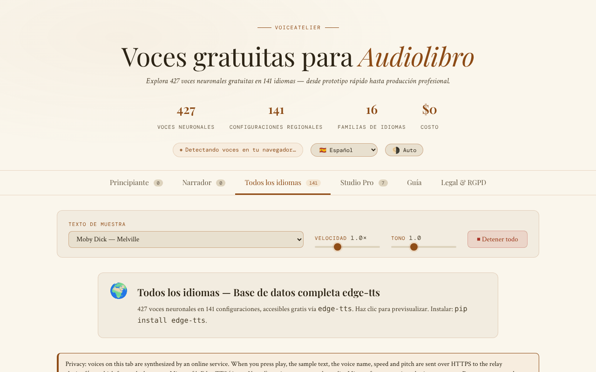

# VoiceAtelier

[English](README.md) · [Română](README.ro.md) · [Français](README.fr.md) · [Italiano](README.it.md) · **Español** · [Português](README.pt.md) · [Deutsch](README.de.md) · [Magyar](README.hu.md)

**Versión:** 1.3.2 · **Última actualización:** 2026-10-22

Idiomas de la interfaz: **Română, English, Français, Italiano, Español, Português (PT), Deutsch, Magyar** + 8 más

Catálogo y guía de voces neuronales gratuitas para audiolibros, en un único archivo HTML.

**En línea:** https://chiuta.github.io/VoiceAtelier/

## Qué es

VoiceAtelier es una aplicación en un único archivo `index.html` que presenta voces de síntesis de voz utilizables gratuitamente para la narración de audiolibros. La interfaz anuncia 427 voces neuronales en 141 idiomas, organizadas por niveles (Starter, Storyteller, Todos los idiomas, Studio Pro), e incluye una guía de flujo de trabajo para la narración de larga duración.

## Funciones

- Seis secciones (pestañas): **Starter**, **Storyteller**, **Todos los idiomas**, **Studio Pro**, **Guía**, **Legal y RGPD**.
- Reproducción de prueba de las voces disponibles en el navegador mediante la Web Speech API (`speechSynthesis`).
- Texto de muestra seleccionable de una lista (fragmentos de Moby Dick, Pride & Prejudice, A Tale of Two Cities, The Time Machine, Anna Karenina, Mrs Dalloway, *Printre inteligențe*, *Nota Zero*), con controles de velocidad y tono y un botón «Detener todo».
- La pestaña «Todos los idiomas»: una cuadrícula de idiomas con búsqueda, un botón de prueba y un botón para copiar el comando `edge-tts` de cada idioma.
- Studio Pro: fichas de presentación de ElevenLabs, Microsoft Edge TTS, Kokoro TTS, Bark, Google Cloud TTS, Coqui TTS y Amazon Polly (límites, idiomas, formatos, enlace).
- Guía: explicación de los tres niveles, criterios para elegir la voz, flujo de trabajo con `edge-tts`, Audacity y ffmpeg (`loudnorm`), requisitos de ACX/Audible.
- Interfaz en 16 idiomas: en, ro, fr, de, es, pt, it, nl, pl, ru, ar, zh, ja, ko, tr, hu.
- Tema automático/claro/oscuro.
- Ventanas informativas (RGPD, cookies, aviso legal, accesibilidad, retirada de contenido, etc.).

## Manual de uso

1. Abre la página. El idioma de la interfaz se detecta automáticamente; puedes cambiarlo desde la lista «Language» de la cabecera.
2. Cambia el tema con el botón de la cabecera (alterna entre automático, claro y oscuro).
3. Elige un texto en «Texto de muestra»; ajusta «Velocidad» y «Tono».
4. En **Starter** y **Storyteller**, pulsa ▶ en la tarjeta de una voz para escucharla (con el teclado: Tab hasta el botón ▶, luego Intro o Espacio). La insignia «On-device» marca las voces locales; las que el navegador/sistema suministra por red llevan la insignia «Voz en línea».
5. En **Todos los idiomas**, busca un idioma y pulsa el botón de prueba o el botón de copiar el comando `edge-tts`.
6. Pulsa «⏹ Detener todo» para detener la reproducción.
7. Consulta **Studio Pro** para las herramientas externas y **Guía** para el flujo de trabajo.
8. Escape cierra las ventanas modales.

## Privacidad y red

- **Almacenamiento local:** `localStorage`, claves `va_lang` (idioma) y `va_theme` (tema). Opcionalmente, la clave `va_endpoint` si estableces manualmente otro relé TTS.
- **Red:** las voces de las pestañas Starter y Storyteller se ejecutan localmente mediante la Web Speech API (la aplicación señala que, si el navegador envía internamente el texto a un servidor, la responsabilidad corresponde al proveedor del navegador).
- **Opt-in explícito:** en la pestaña «Todos los idiomas» (abierta por defecto) una advertencia visible explica qué se envía, y las voces en línea se reproducen **solo después de que marques** el consentimiento («Entiendo y estoy de acuerdo…»). Sin la marca, no se envía nada (verificado: 0 solicitudes al cargar y al hacer clic sin la marca). La marca se conserva en `localStorage` (`va_relay_ok`).
- Al reproducir una voz de la pestaña «Todos los idiomas», el texto de muestra, el nombre de la voz, la velocidad y el tono se envían por HTTPS (`fetch`) al relé **https://alexio.tf/tts**, que genera audio MP3 con `edge-tts` y lo devuelve. **`edge-tts` es una biblioteca no oficial que utiliza el servicio en línea Microsoft Edge TTS: el texto se retransmite, por tanto, a Microsoft**, que lo procesa según sus propias condiciones (no oficial, sin garantía de disponibilidad; lo «gratuito» depende de este servicio). Según la nota de la aplicación, el relé no conserva el texto tras la solicitud (la afirmación se refiere al servidor del autor y no puede verificarse desde este repositorio).
- CSP: `connect-src 'self' https://alexio.tf`. La clave `va_endpoint` (relé alternativo establecido manualmente en `localStorage`) solo funciona para direcciones de `alexio.tf`; para otro relé hay que ampliar la CSP en `index.html`.
- **Atención:** el relé genera audio con `edge-tts`, un cliente no oficial del servicio en línea Microsoft Edge/Azure TTS; por tanto, es probable que el texto de muestra se retransmita también a Microsoft.
- Los enlaces a otros sitios (ElevenLabs, GitHub, Hugging Face, Buy Me a Coffee, etc.) son simples hipervínculos, que se abren solo al hacer clic.
- La aplicación no contiene analítica ni formularios de registro.

## Ejecución local / sin conexión

Descarga `index.html` y ábrelo en el navegador. Las fuentes están incluidas en el archivo. Las pestañas Starter y Storyteller funcionan sin internet, dentro del límite de las voces instaladas en el sistema/navegador. La reproducción desde «Todos los idiomas» requiere internet y acceso a `alexio.tf`.

## Historial / Changelog

- 1.3.3 — 2026-10-22: Pasada móvil a 360 px: todo el texto ≥ 12 px, objetivos ≥ 24 px (píldoras de voz, deslizadores, casilla, enlaces del pie; pestañas y botones ≥ 36 px); etiqueta de versión del pie sincronizada.

- 1.3.2 — 2026-10-22: Se añadieron las cadenas que faltaban en francés, italiano, español, portugués y alemán (aviso de privacidad y consentimiento de las voces en línea, contadores de voces, descripciones de las herramientas de la pestaña Studio); la meta descripción y la descripción del panel fff-kit siguen el idioma de la interfaz.
- 1.2.0 — 2026-10-18: nueva muestra en la lista: *Nota Zero* (dos frases del vol. I).
- 1.1.0 — 2026-10-14: copia de seguridad y etiquetado de datos (fff-kit).

- 1.0.0 — 2026-10-12: la versión y la fecha de la última actualización se muestran en la aplicación
- Ronda 7: eliminada la afirmación sin respaldo de que las herramientas de Studio Pro producen audio «indistinguishable from professional narration» (y «calidad broadcast») en los 15 idiomas — ahora el texto dice que la naturalidad varía de una voz a otra y recomienda escuchar las muestras; el estado vacío de Starter/Storyteller (sin voces locales) tiene ahora un botón «→ Todos los idiomas» que lleva directamente a las voces en línea.
- Las voces del navegador que no son locales (`localService = false`) reciben la insignia «Voz en línea» (traducida a los 15 idiomas), para que quede claro cuándo el texto puede salir hacia el proveedor del navegador; la tarjeta de voz ya no es `role="button"` con un botón ▶ dentro (infracción axe «nested-interactive», visible solo cuando existen voces), y el botón ▶ es el control enfocable; CSP: `script-src` mediante hash SHA-256 (2 scripts), sin `'unsafe-inline'`.
- Eliminados los 44 manejadores en línea (`onclick`/`oninput`/`onchange`); las acciones usan ahora atributos `data-click`/`data-input`/`data-change`/`data-overlay` y escuchadores delegados.
- Si no existe ninguna voz local (ni siquiera tras 5 s), las páginas Starter/Storyteller muestran ahora un estado vacío explícito, en los 15 idiomas, con remisión a la pestaña «Todos los idiomas», en lugar de «Loading voices…».
- Textos de marketing moderados: «The gold standard» → «A leading commercial service», «Unlimited (unofficial)» → «No published limit (unofficial)».
- El widget de apoyo es un hito `complementary`; axe-core: 0 infracciones a 1280 y 360 px. Se corrigió la sección de red del README (CSP actual: `connect-src 'self' https://alexio.tf`).

## Licencia

MIT — véase el archivo LICENSE

## Auditoría

2026-10-10: verificado el número de voces (427) y de idiomas (141) de la página; la única solicitud externa es `POST https://alexio.tf/tts` por acción del usuario; corregidos el contraste y un elemento oculto enfocable. La página no ofrece reparto de voces por personaje ni SSML.

## Autor

Alexio — Alexandru-Ionuț Chiuță, contacto: alexio@trom.tf
