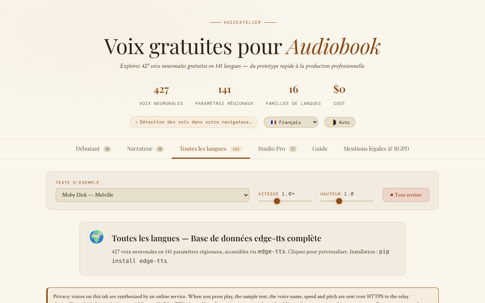

# VoiceAtelier

[English](README.md) · [Română](README.ro.md) · **Français** · [Italiano](README.it.md) · [Español](README.es.md) · [Português](README.pt.md) · [Deutsch](README.de.md) · [Magyar](README.hu.md)

**Version :** 1.3.2 · **Dernière mise à jour :** 2026-10-22

Langues de l'interface : **Română, English, Français, Italiano, Español, Português (PT), Deutsch, Magyar** + 8 autres

Catalogue et guide de voix neuronales gratuites pour livres audio, dans un seul fichier HTML.

**En ligne :** https://chiuta.github.io/VoiceAtelier/

## Qu'est-ce que c'est

VoiceAtelier est une application tenant dans un seul fichier `index.html`, qui présente des voix de synthèse vocale utilisables gratuitement pour la narration de livres audio. L'interface annonce 427 voix neuronales dans 141 langues, organisées par niveaux (Starter, Storyteller, Toutes les langues, Studio Pro), et comprend un guide de flux de travail pour la narration de longue durée.

## Fonctions

- Six sections (onglets) : **Starter**, **Storyteller**, **Toutes les langues**, **Studio Pro**, **Guide**, **Légal et RGPD**.
- Lecture d'essai des voix disponibles dans le navigateur via la Web Speech API (`speechSynthesis`).
- Texte d'exemple sélectionnable dans une liste (extraits de Moby Dick, Pride & Prejudice, A Tale of Two Cities, The Time Machine, Anna Karenina, Mrs Dalloway, *Printre inteligențe*, *Nota Zero*), avec commandes de vitesse et de hauteur et un bouton « Tout arrêter ».
- L'onglet « Toutes les langues » : une grille de langues avec recherche, un bouton d'essai et un bouton de copie de la commande `edge-tts` pour chaque langue.
- Studio Pro : fiches de présentation d'ElevenLabs, Microsoft Edge TTS, Kokoro TTS, Bark, Google Cloud TTS, Coqui TTS et Amazon Polly (limites, langues, formats, lien).
- Guide : explication des trois niveaux, critères de choix d'une voix, flux de travail avec `edge-tts`, Audacity et ffmpeg (`loudnorm`), exigences ACX/Audible.
- Interface en 16 langues : en, ro, fr, de, es, pt, it, nl, pl, ru, ar, zh, ja, ko, tr, hu.
- Thème automatique/clair/sombre.
- Fenêtres d'information (RGPD, cookies, mentions légales, accessibilité, retrait de contenu, etc.).

## Mode d'emploi

1. Ouvrez la page. La langue de l'interface est détectée automatiquement ; vous pouvez la changer depuis la liste « Language » de l'en-tête.
2. Changez de thème avec le bouton de l'en-tête (il alterne entre automatique, clair, sombre).
3. Choisissez un texte dans « Texte d'exemple » ; réglez la « Vitesse » et la « Hauteur ».
4. Dans **Starter** et **Storyteller**, appuyez sur ▶ sur la carte d'une voix pour l'écouter (au clavier : Tab jusqu'au bouton ▶, puis Entrée ou Espace). Le badge « On-device » signale les voix locales ; celles fournies par le réseau via le navigateur/le système portent le badge « Voix en ligne ».
5. Dans **Toutes les langues**, cherchez une langue, puis appuyez sur le bouton d'essai ou sur le bouton de copie de la commande `edge-tts`.
6. Appuyez sur « ⏹ Tout arrêter » pour interrompre la lecture.
7. Consultez **Studio Pro** pour les outils externes et **Guide** pour le flux de travail.
8. Échap ferme les fenêtres modales.

## Confidentialité et réseau

- **Stockage local :** `localStorage`, clés `va_lang` (langue) et `va_theme` (thème). Éventuellement, la clé `va_endpoint` si vous définissez manuellement un autre relais TTS.
- **Réseau :** les voix des onglets Starter et Storyteller s'exécutent localement via la Web Speech API (l'application précise que, si le navigateur envoie en interne le texte à un serveur, la responsabilité incombe à l'éditeur du navigateur).
- **Opt-in explicite :** dans l'onglet « Toutes les langues » (ouvert par défaut), un avertissement visible explique ce qui est envoyé, et les voix en ligne ne sont lues **qu'après que vous avez coché** l'accord (« Je comprends et j'accepte… »). Sans cette case cochée, rien n'est envoyé (vérifié : 0 requête au chargement et au clic sans case cochée). La case cochée est conservée dans `localStorage` (`va_relay_ok`).
- Lors de la lecture d'une voix de l'onglet « Toutes les langues », le texte d'exemple, le nom de la voix, la vitesse et la hauteur sont envoyés via HTTPS (`fetch`) au relais **https://alexio.tf/tts**, qui génère l'audio MP3 avec `edge-tts` et le renvoie. **`edge-tts` est une bibliothèque non officielle qui utilise le service en ligne Microsoft Edge TTS : le texte est donc retransmis à Microsoft**, qui le traite selon ses propres conditions (non officiel, sans garantie de disponibilité ; la « gratuité » dépend de ce service). Selon la note de l'application, le relais ne conserve pas le texte après la requête (l'affirmation concerne le serveur de l'auteur et ne peut pas être vérifiée depuis ce dépôt).
- CSP : `connect-src 'self' https://alexio.tf`. La clé `va_endpoint` (relais alternatif défini manuellement dans `localStorage`) ne fonctionne que pour des adresses sous `alexio.tf` ; pour un autre relais, il faut étendre la CSP dans `index.html`.
- **Attention :** le relais génère l'audio avec `edge-tts`, un client non officiel du service en ligne Microsoft Edge/Azure TTS ; il est donc probable que le texte d'exemple soit également retransmis à Microsoft.
- Les liens vers d'autres sites (ElevenLabs, GitHub, Hugging Face, Buy Me a Coffee, etc.) sont de simples hyperliens, ouverts uniquement au clic.
- L'application ne contient ni analytique ni formulaire d'inscription.

## Exécution locale / hors ligne

Téléchargez `index.html` et ouvrez-le dans le navigateur. Les polices sont incluses dans le fichier. Les onglets Starter et Storyteller fonctionnent sans internet, dans la limite des voix installées dans le système/navigateur. La lecture depuis « Toutes les langues » nécessite internet et l'accès à `alexio.tf`.

## Historique / Changelog

- 1.3.2 — 2026-10-22: Chaînes manquantes ajoutées en français, italien, espagnol, portugais et allemand (note de confidentialité et consentement pour les voix en ligne, compteurs de voix, descriptions des outils de l'onglet Studio) ; la méta-description et la description du panneau fff-kit suivent la langue de l'interface.
- 1.2.0 — 2026-10-18 : nouvel exemple dans la liste : *Nota Zero* (deux phrases du vol. I).
- 1.1.0 — 2026-10-14 : sauvegarde et étiquetage des données (fff-kit).

- 1.0.0 — 2026-10-12 : la version et la date de dernière mise à jour sont affichées dans l'application
- Tour 7 : suppression de l'affirmation non étayée selon laquelle les outils Studio Pro produisent un audio « indistinguishable from professional narration » (et « qualité broadcast ») dans les 15 langues — le texte indique désormais que le naturel varie d'une voix à l'autre et recommande d'écouter les exemples ; l'état vide de Starter/Storyteller (sans voix locales) comporte désormais un bouton « → Toutes les langues » qui mène directement aux voix en ligne.
- Les voix du navigateur qui ne sont pas locales (`localService = false`) reçoivent le badge « Voix en ligne » (traduit dans les 15 langues), afin qu'il soit clair quand le texte peut partir vers l'éditeur du navigateur ; la carte de voix n'est plus `role="button"` avec un bouton ▶ à l'intérieur (violation axe « nested-interactive », visible uniquement lorsque des voix existent), et le bouton ▶ est le contrôle focalisable ; CSP : `script-src` par hachage SHA-256 (2 scripts), sans `'unsafe-inline'`.
- Suppression des 44 gestionnaires en ligne (`onclick`/`oninput`/`onchange`) ; les actions utilisent désormais les attributs `data-click`/`data-input`/`data-change`/`data-overlay` et des écouteurs délégués.
- S'il n'existe aucune voix locale (même après 5 s), les pages Starter/Storyteller affichent désormais un état vide explicite, dans les 15 langues, renvoyant à l'onglet « Toutes les langues », au lieu de « Loading voices… ».
- Textes marketing tempérés : « The gold standard » → « A leading commercial service », « Unlimited (unofficial) » → « No published limit (unofficial) ».
- Le widget de soutien est un repère `complementary` ; axe-core : 0 violation à 1280 et 360 px. La section réseau du README a été corrigée (CSP actuelle : `connect-src 'self' https://alexio.tf`).

## Licence

MIT — voir le fichier LICENSE

## Audit

2026-10-10 : vérification du nombre de voix (427) et de langues (141) dans la page ; la seule requête externe est `POST https://alexio.tf/tts` sur action de l'utilisateur ; correction du contraste et d'un élément masqué focalisable. La page ne propose ni distribution par personnage ni SSML.

## Auteur

Alexio — Alexandru-Ionuț Chiuță, contact : alexio@trom.tf
