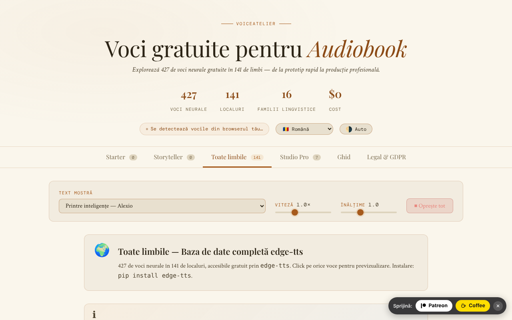

# VoiceAtelier

[English](README.md) · [Română](README.ro.md) · [Français](README.fr.md) · **Italiano** · [Español](README.es.md) · [Português](README.pt.md) · [Deutsch](README.de.md) · [Magyar](README.hu.md)

**Versione:** 1.3.0 · **Ultimo aggiornamento:** 2026-10-19

Lingue dell'interfaccia: **Română, English, Français, Italiano, Español, Português (PT), Deutsch, Magyar** + altre 8

Catalogo e guida di voci neurali gratuite per audiolibri, in un unico file HTML.

**Online:** https://chiuta.github.io/VoiceAtelier/

## Che cos'è

VoiceAtelier è un'applicazione in un unico file `index.html` che presenta voci di sintesi vocale utilizzabili gratuitamente per la narrazione di audiolibri. L'interfaccia annuncia 427 voci neurali in 141 lingue, organizzate per livelli (Starter, Storyteller, Tutte le lingue, Studio Pro), e include una guida al flusso di lavoro per la narrazione di lunga durata.

## Funzioni

- Sei sezioni (schede): **Starter**, **Storyteller**, **Tutte le lingue**, **Studio Pro**, **Guida**, **Legale e GDPR**.
- Riproduzione di prova delle voci disponibili nel browser tramite la Web Speech API (`speechSynthesis`).
- Testo di esempio selezionabile da un elenco (brani da Moby Dick, Pride & Prejudice, A Tale of Two Cities, The Time Machine, Anna Karenina, Mrs Dalloway, *Printre inteligențe*, *Nota Zero*), con comandi per velocità e tono e un pulsante «Ferma tutto».
- La scheda «Tutte le lingue»: una griglia di lingue con ricerca, un pulsante di prova e un pulsante per copiare il comando `edge-tts` per ciascuna lingua.
- Studio Pro: schede di presentazione di ElevenLabs, Microsoft Edge TTS, Kokoro TTS, Bark, Google Cloud TTS, Coqui TTS e Amazon Polly (limiti, lingue, formati, link).
- Guida: spiegazione dei tre livelli, criteri di scelta della voce, flusso di lavoro con `edge-tts`, Audacity e ffmpeg (`loudnorm`), requisiti ACX/Audible.
- Interfaccia in 16 lingue: en, ro, fr, de, es, pt, it, nl, pl, ru, ar, zh, ja, ko, tr, hu.
- Tema automatico/chiaro/scuro.
- Finestre informative (GDPR, cookie, note legali, accessibilità, rimozione di contenuti, ecc.).

## Manuale d'uso

1. Apri la pagina. La lingua dell'interfaccia viene rilevata automaticamente; puoi cambiarla dall'elenco «Language» nell'intestazione.
2. Cambia tema con il pulsante nell'intestazione (alterna tra automatico, chiaro, scuro).
3. Scegli un testo da «Testo di esempio»; regola «Velocità» e «Tono».
4. In **Starter** e **Storyteller**, premi ▶ sulla scheda di una voce per ascoltarla (da tastiera: Tab fino al pulsante ▶, poi Invio o Spazio). Il badge «On-device» contrassegna le voci locali; quelle fornite tramite rete dal browser/sistema portano il badge «Voce online».
5. In **Tutte le lingue**, cerca una lingua, poi premi il pulsante di prova o il pulsante per copiare il comando `edge-tts`.
6. Premi «⏹ Ferma tutto» per interrompere la riproduzione.
7. Consulta **Studio Pro** per gli strumenti esterni e **Guida** per il flusso di lavoro.
8. Esc chiude le finestre modali.

## Privacy e rete

- **Archiviazione locale:** `localStorage`, chiavi `va_lang` (lingua) e `va_theme` (tema). Facoltativamente, la chiave `va_endpoint` se imposti manualmente un altro relay TTS.
- **Rete:** le voci delle schede Starter e Storyteller funzionano in locale tramite la Web Speech API (l'applicazione precisa che, se il browser invia internamente il testo a un server, la responsabilità spetta al fornitore del browser).
- **Opt-in esplicito:** nella scheda «Tutte le lingue» (aperta per impostazione predefinita) un avviso ben visibile spiega che cosa viene inviato, e le voci online vengono riprodotte **solo dopo che hai spuntato** il consenso («Ho capito e accetto…»). Senza la spunta non viene inviato nulla (verificato: 0 richieste al caricamento e al clic senza spunta). La spunta viene ricordata in `localStorage` (`va_relay_ok`).
- Quando si riproduce una voce dalla scheda «Tutte le lingue», il testo di esempio, il nome della voce, la velocità e il tono vengono inviati tramite HTTPS (`fetch`) al relay **https://alexio.tf/tts**, che genera audio MP3 con `edge-tts` e lo restituisce. **`edge-tts` è una libreria non ufficiale che usa il servizio online Microsoft Edge TTS: il testo viene quindi ritrasmesso a Microsoft**, che lo elabora secondo le proprie condizioni (non ufficiale, senza garanzia di disponibilità; la «gratuità» dipende da questo servizio). Secondo la nota nell'applicazione, il relay non conserva il testo dopo la richiesta (l'affermazione riguarda il server dell'autore e non può essere verificata da questo repository).
- CSP: `connect-src 'self' https://alexio.tf`. La chiave `va_endpoint` (relay alternativo impostato manualmente in `localStorage`) funziona solo per indirizzi su `alexio.tf`; per un altro relay occorre estendere la CSP in `index.html`.
- **Attenzione:** il relay genera audio con `edge-tts`, un client non ufficiale per il servizio online Microsoft Edge/Azure TTS; è quindi probabile che il testo di esempio venga ritrasmesso anche a Microsoft.
- I link verso altri siti (ElevenLabs, GitHub, Hugging Face, Buy Me a Coffee, ecc.) sono semplici collegamenti ipertestuali, aperti solo al clic.
- L'applicazione non contiene analytics né moduli di registrazione.

## Esecuzione locale / offline

Scarica `index.html` e aprilo nel browser. I font sono inclusi nel file. Le schede Starter e Storyteller funzionano senza internet, nei limiti delle voci installate nel sistema/browser. La riproduzione da «Tutte le lingue» richiede internet e accesso a `alexio.tf`.

## Cronologia / Changelog

- 1.2.0 — 2026-10-18: nuovo esempio nell'elenco: *Nota Zero* (due frasi dal vol. I).
- 1.1.0 — 2026-10-14: backup ed etichettatura dei dati (fff-kit).

- 1.0.0 — 2026-10-12: la versione e la data dell'ultimo aggiornamento sono mostrate nell'applicazione
- Giro 7: rimossa l'affermazione non supportata secondo cui gli strumenti Studio Pro producono audio «indistinguishable from professional narration» (e «qualità broadcast») in tutte e 15 le lingue — il testo ora dice che la naturalezza varia da voce a voce e consiglia di ascoltare gli esempi; lo stato vuoto di Starter/Storyteller (senza voci locali) ha ora un pulsante «→ Tutte le lingue» che porta direttamente alle voci online.
- Le voci del browser che non sono locali (`localService = false`) ricevono il badge «Voce online» (tradotto nelle 15 lingue), in modo che sia chiaro quando il testo può partire verso il fornitore del browser; la scheda della voce non è più `role="button"` con un pulsante ▶ all'interno (violazione axe «nested-interactive», visibile solo quando esistono voci), e il pulsante ▶ è il controllo attivabile con il focus; CSP: `script-src` tramite hash SHA-256 (2 script), senza `'unsafe-inline'`.
- Rimossi tutti i 44 gestori inline (`onclick`/`oninput`/`onchange`); le azioni usano ora gli attributi `data-click`/`data-input`/`data-change`/`data-overlay` e listener delegati.
- Se non esiste alcuna voce locale (nemmeno dopo 5 s), le pagine Starter/Storyteller mostrano ora uno stato vuoto esplicito, in tutte e 15 le lingue, con rinvio alla scheda «Tutte le lingue», invece di «Loading voices…».
- Testi di marketing attenuati: «The gold standard» → «A leading commercial service», «Unlimited (unofficial)» → «No published limit (unofficial)».
- Il widget di sostegno è un riferimento `complementary`; axe-core: 0 violazioni a 1280 e 360 px. La sezione di rete del README è stata corretta (CSP attuale: `connect-src 'self' https://alexio.tf`).

## Licenza

MIT — vedi il file LICENSE

## Audit

2026-10-10: verificato il numero di voci (427) e di lingue (141) nella pagina; l'unica richiesta esterna è `POST https://alexio.tf/tts` su azione dell'utente; corretti il contrasto e un elemento nascosto raggiungibile con il focus. La pagina non offre assegnazione di voci per personaggio né SSML.

## Autore

Alexio — Alexandru-Ionuț Chiuță, contatto: alexio@trom.tf
