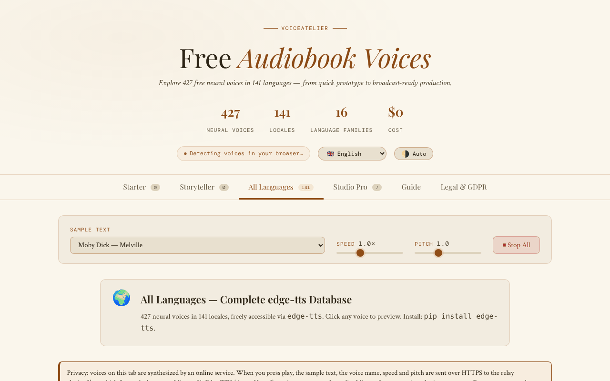

# VoiceAtelier

**English** · [Română](README.ro.md) · [Français](README.fr.md) · [Italiano](README.it.md) · [Español](README.es.md) · [Português](README.pt.md) · [Deutsch](README.de.md) · [Magyar](README.hu.md)

**Version:** 1.3.2 · **Last updated:** 2026-10-22

Interface languages: **Română, English, Français, Italiano, Español, Português (PT), Deutsch, Magyar** + 8 more

A catalogue and guide to free neural voices for audiobooks, in a single HTML file.

**Live:** https://chiuta.github.io/VoiceAtelier/

## What it is

VoiceAtelier is an application in a single `index.html` file that presents speech-synthesis voices that can be used free of charge for audiobook narration. The interface announces 427 neural voices in 141 languages, organised in tiers (Starter, Storyteller, All languages, Studio Pro), and includes a workflow guide for long-form narration.

## Features

- Six sections (tabs): **Starter**, **Storyteller**, **All languages**, **Studio Pro**, **Guide**, **Legal & GDPR**.
- Trial playback of the voices available in the browser through the Web Speech API (`speechSynthesis`).
- Sample text selectable from a list (excerpts from Moby Dick, Pride & Prejudice, A Tale of Two Cities, The Time Machine, Anna Karenina, Mrs Dalloway, *Printre inteligențe*, *Nota Zero*), with speed and pitch controls and a "Stop all" button.
- The "All languages" tab: a language grid with search, a trial button and a button that copies the `edge-tts` command for each language.
- Studio Pro: overview sheets for ElevenLabs, Microsoft Edge TTS, Kokoro TTS, Bark, Google Cloud TTS, Coqui TTS and Amazon Polly (limits, languages, formats, link).
- Guide: an explanation of the three tiers, criteria for choosing a voice, a workflow with `edge-tts`, Audacity and ffmpeg (`loudnorm`), ACX/Audible requirements.
- Interface in 16 languages: en, ro, fr, de, es, pt, it, nl, pl, ru, ar, zh, ja, ko, tr, hu.
- Automatic/light/dark theme.
- Information dialogs (GDPR, cookies, imprint, accessibility, takedown, etc.).

## User guide

1. Open the page. The interface language is detected automatically; you can change it from the "Language" list in the header.
2. Switch the theme with the button in the header (it cycles between automatic, light, dark).
3. Choose a text from "Sample text"; adjust "Speed" and "Pitch".
4. In **Starter** and **Storyteller**, press ▶ on a voice card to hear it (from the keyboard: Tab to the ▶ button, then Enter or Space). The "On-device" badge marks local voices; those delivered over the network by the browser/system carry the "Online voice" badge.
5. In **All languages**, search for a language, then press the trial button or the button that copies the `edge-tts` command.
6. Press "⏹ Stop all" to stop playback.
7. See **Studio Pro** for external tools and **Guide** for the workflow.
8. Escape closes the modal dialogs.

## Privacy and network

- **Local storage:** `localStorage`, keys `va_lang` (language) and `va_theme` (theme). Optionally, the key `va_endpoint` if you manually set a different TTS relay.
- **Network:** the voices in the Starter and Storyteller tabs run locally through the Web Speech API (the application notes that, if the browser internally sends the text to a server, the responsibility lies with the browser vendor).
- **Explicit opt-in:** in the "All languages" tab (open by default) a visible warning explains what is sent, and online voices are played **only after you tick** the consent box ("I understand and agree…"). Without the tick, nothing is sent (verified: 0 requests on load and on click without the tick). The tick is remembered in `localStorage` (`va_relay_ok`).
- When a voice from the "All languages" tab is played, the sample text, the voice name, the speed and the pitch are sent over HTTPS (`fetch`) to the relay **https://alexio.tf/tts**, which generates MP3 audio with `edge-tts` and returns it. **`edge-tts` is an unofficial library that uses the online Microsoft Edge TTS service: the text is therefore forwarded to Microsoft**, which processes it under its own terms (unofficial, no availability guarantee; "free" depends on this service). According to the note in the application, the relay does not keep the text after the request (the claim concerns the author's server and cannot be verified from this repository).
- CSP: `connect-src 'self' https://alexio.tf`. The `va_endpoint` key (an alternative relay set manually in `localStorage`) works only for addresses on `alexio.tf`; for another relay the CSP in `index.html` must be extended.
- **Warning:** the relay generates audio with `edge-tts`, an unofficial client for the online Microsoft Edge/Azure TTS service; it is therefore likely that the sample text is also forwarded to Microsoft.
- Links to other sites (ElevenLabs, GitHub, Hugging Face, Buy Me a Coffee, etc.) are plain hyperlinks, opened only on click.
- The application contains no analytics or registration forms.

## Running locally / offline

Download `index.html` and open it in the browser. The fonts are included in the file. The Starter and Storyteller tabs work without internet, within the limits of the voices installed in the system/browser. Playback from "All languages" requires internet and access to `alexio.tf`.

## History / Changelog

- 1.3.2 — 2026-10-22: Missing French, Italian, Spanish, Portuguese and German strings added (online-voice privacy notice and consent, voice counters, tool descriptions in the Studio tab); meta description and fff-kit panel description now follow the interface language.
- 1.2.0 — 2026-10-18: New sample in the list: *Nota Zero* (two sentences from Vol. I).
- 1.1.0 — 2026-10-14: Backup and data labelling (fff-kit).

- 1.0.0 — 2026-10-12: the version and the last-updated date are shown in the application
- Round 7: removed the unsupported claim that the Studio Pro tools produce audio "indistinguishable from professional narration" (and "broadcast quality") in all 15 languages — the text now says that naturalness differs from voice to voice and recommends listening to the samples; the empty state in Starter/Storyteller (no local voices) now has a "→ All languages" button that leads directly to the online voices.
- Browser voices that are not local (`localService = false`) get the "Online voice" badge (translated into the 15 languages), so it is clear when the text may leave for the browser vendor; the voice card is no longer `role="button"` with a ▶ button inside (axe "nested-interactive" violation, visible only when voices exist), and the ▶ button is the focusable control; CSP: `script-src` by SHA-256 hash (2 scripts), without `'unsafe-inline'`.
- Removed all 44 inline handlers (`onclick`/`oninput`/`onchange`); actions now use `data-click`/`data-input`/`data-change`/`data-overlay` attributes and delegated listeners.
- If there is no local voice at all (not even after 5 s), the Starter/Storyteller pages now show an explicit empty state, in all 15 languages, pointing to the "All languages" tab, instead of "Loading voices…".
- Marketing texts toned down: "The gold standard" → "A leading commercial service", "Unlimited (unofficial)" → "No published limit (unofficial)".
- The support widget is a `complementary` landmark; axe-core: 0 violations at 1280 and 360 px. The network section of the README was corrected (current CSP: `connect-src 'self' https://alexio.tf`).

## Licence

MIT — see the LICENSE file

## Audit

2026-10-10: verified the number of voices (427) and languages (141) on the page; the only external request is `POST https://alexio.tf/tts` on user action; fixed the contrast and a hidden focusable element. The page does not offer per-character casting or SSML.

## Author

Alexio — Alexandru-Ionuț Chiuță, contact: alexio@trom.tf
