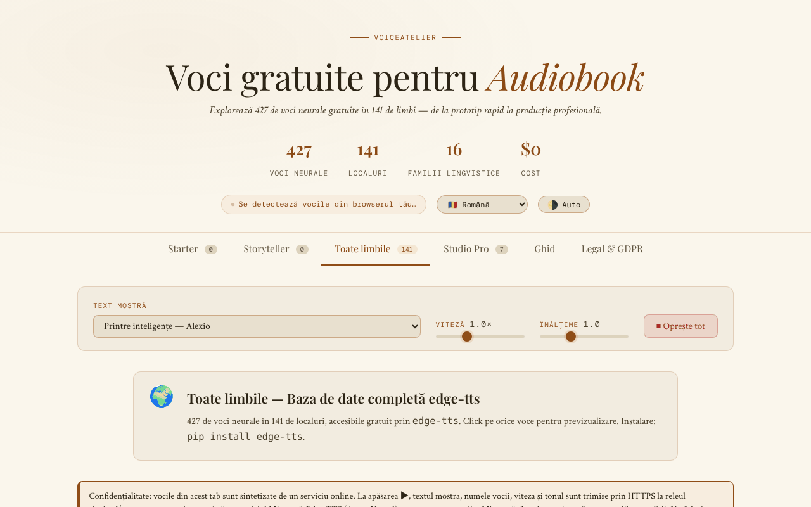

# VoiceAtelier

[English](README.md) · **Română** · [Français](README.fr.md) · [Italiano](README.it.md) · [Español](README.es.md) · [Português](README.pt.md) · [Deutsch](README.de.md) · [Magyar](README.hu.md)

**Versiune:** 1.3.1 · **Ultima actualizare:** 2026-10-19

Limbile interfeței: **Română, English, Français, Italiano, Español, Português (PT), Deutsch, Magyar** + încă 8

Catalog și ghid de voci neurale gratuite pentru audiobook, într-un singur fișier HTML.

**Live:** https://chiuta.github.io/VoiceAtelier/

## Ce este

VoiceAtelier este o aplicație dintr-un singur fișier `index.html` care prezintă voci de sinteză vocală utilizabile gratuit pentru narațiune de audiobook. Aplicația anunță în interfață 427 de voci neurale în 141 de limbi, organizate pe niveluri (Starter, Storyteller, Toate limbile, Studio Pro), și include un ghid de flux de lucru pentru narațiune de lungă durată.

## Funcții

- Șase secțiuni (tab-uri): **Starter**, **Storyteller**, **Toate limbile**, **Studio Pro**, **Ghid**, **Legal & GDPR**.
- Redare de probă a vocilor disponibile în browser prin Web Speech API (`speechSynthesis`).
- Text mostră selectabil dintr-o listă (fragmente din Moby Dick, Pride & Prejudice, A Tale of Two Cities, The Time Machine, Anna Karenina, Mrs Dalloway, *Printre inteligențe*, *Nota Zero*), cu comenzi pentru viteză și ton și buton „Oprește tot”.
- Tab-ul „Toate limbile”: grilă de limbi cu căutare, buton de probă și buton de copiere a comenzii `edge-tts` pentru fiecare limbă.
- Studio Pro: fișe de prezentare pentru ElevenLabs, Microsoft Edge TTS, Kokoro TTS, Bark, Google Cloud TTS, Coqui TTS și Amazon Polly (limite, limbi, formate, link).
- Ghid: explicarea celor trei niveluri, criterii de alegere a vocii, flux de lucru cu `edge-tts`, Audacity și ffmpeg (`loudnorm`), cerințe ACX/Audible.
- Interfață în 16 limbi: en, ro, fr, de, es, pt, it, nl, pl, ru, ar, zh, ja, ko, tr, hu.
- Temă automată/luminoasă/întunecată.
- Ferestre informative (GDPR, cookies, impresum, accesibilitate, takedown, ș.a.).

## Manual de utilizare

1. Deschide pagina. Limba interfeței este detectată automat; o poți schimba din lista „Language” din antet.
2. Comută tema cu butonul din antet (ciclează între automat, luminos, întunecat).
3. Alege un text din „Text mostră”; ajustează „Viteză” și „Ton”.
4. În **Starter** și **Storyteller**, apasă ▶ pe cardul unei voci pentru a o auzi (de la tastatură: Tab până la butonul ▶, apoi Enter sau Spațiu). Insigna „On-device” marchează vocile locale; cele furnizate prin rețea de browser/sistem poartă insigna „Voce online”.
5. În **Toate limbile**, caută o limbă, apoi apasă butonul de probă sau butonul de copiere a comenzii `edge-tts`.
6. Apasă „⏹ Oprește tot” pentru a opri redarea.
7. Consultă **Studio Pro** pentru instrumente externe și **Ghid** pentru fluxul de lucru.
8. Escape închide ferestrele modale.

## Confidențialitate și rețea

- **Stocare locală:** `localStorage`, chei `va_lang` (limba) și `va_theme` (tema). Opțional, cheia `va_endpoint` dacă setezi manual un alt releu TTS.
- **Rețea:** vocile din tab-urile Starter și Storyteller rulează local prin Web Speech API (aplicația notează că, dacă browserul trimite intern textul unui server, responsabilitatea aparține furnizorului browserului).
- **Opt-in explicit:** în tab-ul „Toate limbile” (deschis implicit) un avertisment vizibil explică ce pleacă, iar vocile online se redau **doar după ce bifezi** acordul („Înțeleg și sunt de acord…”). Fără bifă, nu se trimite nimic (verificat: 0 cereri la încărcare și la clic fără bifă). Bifa se reține în `localStorage` (`va_relay_ok`).
- La redarea unei voci din tab-ul „Toate limbile”, textul mostră, numele vocii, viteza și tonul sunt trimise prin HTTPS (`fetch`) la releul **https://alexio.tf/tts**, care generează audio MP3 cu `edge-tts` și îl returnează. **`edge-tts` este o bibliotecă neoficială care folosește serviciul online Microsoft Edge TTS: textul este deci retransmis către Microsoft**, care îl prelucrează conform propriilor condiții (neoficial, fără garanția disponibilității; „gratuit" depinde de acest serviciu). Conform notei din aplicație, releul nu păstrează textul după cerere (afirmația privește serverul autorului și nu poate fi verificată din acest repository).
- CSP: `connect-src 'self' https://alexio.tf`. Cheia `va_endpoint` (releu alternativ setat manual în `localStorage`) funcționează doar pentru adrese de pe `alexio.tf`; pentru alt releu trebuie extins CSP-ul din `index.html`.
- **Atenție:** releul generează audio cu `edge-tts`, un client neoficial pentru serviciul online Microsoft Edge/Azure TTS; este deci probabil ca textul mostră să fie retransmis și către Microsoft.
- Linkurile către alte site-uri (ElevenLabs, GitHub, Hugging Face, Buy Me a Coffee etc.) sunt simple hiperlegături, deschise doar la click.
- Aplicația nu conține analytics sau formulare de înregistrare.

## Rulare locală / offline

Descarcă `index.html` și deschide-l în browser. Fonturile sunt incluse în fișier. Tab-urile Starter și Storyteller funcționează fără internet, în limita vocilor instalate în sistem/browser. Redarea din „Toate limbile” necesită internet și acces la `alexio.tf`.

## Istoric / Changelog

- 1.2.0 — 2026-10-18: Mostră nouă în listă: *Nota Zero* (două propoziții din Vol. I).
- 1.1.0 — 2026-10-14: Copie de rezervă și etichetare date (fff-kit).

- 1.0.0 — 2026-10-12: versiunea și data ultimei actualizări sunt afișate în aplicație
- Runda 7: eliminată afirmația nesusținută că uneltele Studio Pro produc audio „indistinguishable from professional narration” (și „calitate broadcast”) în toate cele 15 limbi — acum textul spune că naturalețea diferă de la voce la voce și recomandă ascultarea mostrelor; starea goală din Starter/Storyteller (fără voci locale) are acum un buton „→ Toate limbile” care duce direct la vocile online.
- Vocile browserului care nu sunt locale (`localService = false`) primesc insigna „Voce online” (tradusă în cele 15 limbi), ca să fie clar când textul poate pleca spre furnizorul browserului; cardul de voce nu mai este `role="button"` cu buton ▶ în interior (violare axe „nested-interactive”, vizibilă doar când există voci), iar butonul ▶ este controlul focusabil; CSP: `script-src` pe hash SHA-256 (2 scripturi), fără `'unsafe-inline'`.
- Eliminate toate cele 44 de handlere inline (`onclick`/`oninput`/`onchange`); acțiunile folosesc acum atribute `data-click`/`data-input`/`data-change`/`data-overlay` și ascultători delegați.
- Dacă nu există nicio voce locală (nici după 5 s), paginile Starter/Storyteller afișează acum o stare goală explicită, în toate cele 15 limbi, cu trimitere la fila „Toate limbile”, în loc de „Loading voices…”.
- Texte de marketing temperate: „The gold standard” → „A leading commercial service”, „Unlimited (unofficial)” → „No published limit (unofficial)”.
- Widgetul de sprijin este reper `complementary`; axe-core: 0 violări la 1280 și 360 px. Secțiunea de rețea din README a fost corectată (CSP actual: `connect-src 'self' https://alexio.tf`).

## Licență

MIT — vezi fișierul LICENSE

## Audit

2026-10-10: verificat numărul de voci (427) și de limbi (141) din pagină; singura cerere externă este `POST https://alexio.tf/tts` la acțiunea utilizatorului; corectate contrastul și un element ascuns focusabil. Pagina nu oferă per-character casting sau SSML.

## Autor

Alexio — Alexandru-Ionuț Chiuță, contact: alexio@trom.tf

## Rezumat

VoiceAtelier este un catalog și ghid într-un singur fișier HTML al vocilor neuronale gratuite pentru naratarea cărților audio, cu interfață în 16 limbi. Vocile Starter/Storyteller se redau local prin Web Speech API; fila „Toate limbile” trimite textul-probă și numele vocii către releul alexio.tf/tts pentru a obține audio MP3. Setările (limba, tema) se păstrează în localStorage. Licență MIT.
